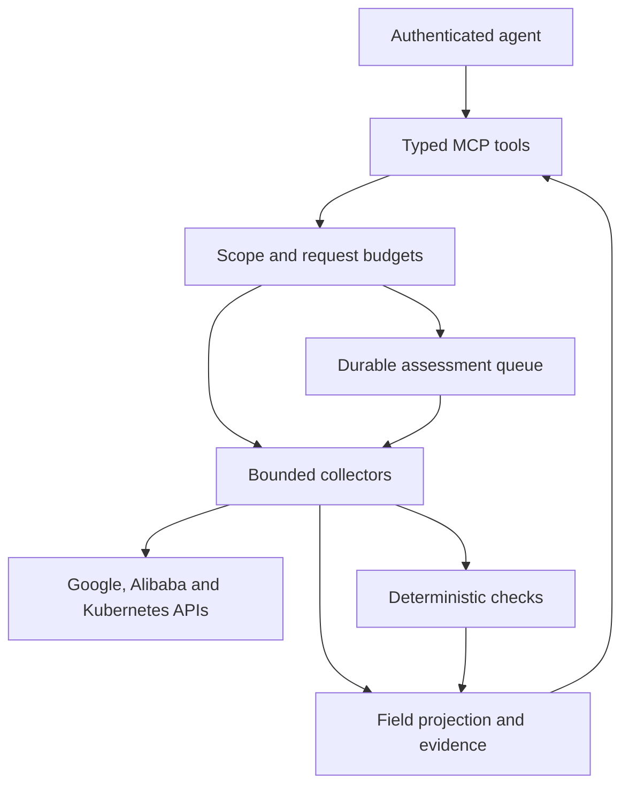

# Architecture

Sec-Auditor exposes a restricted security evidence service through MCP. GCP uses
Google REST APIs and official ADC; Alibaba uses a compiled read catalog, the
official credential chain and official request signers. Kubernetes reads use the
same explicit kind allowlist on GKE and registered ACK clusters. Caller inputs
never become shell commands, executable kubeconfigs, arbitrary URLs or cloud
mutation requests.

The catalog contains 91 GCP kinds/160 list-get variants and 65 Alibaba kinds/75
configuration query variants, with 29 shared Kubernetes kinds. Counts do not imply
universal coverage. The [question matrix](query-coverage.md), provider references
and runtime capabilities describe exact support and exclusions. The check engine
has 211 registrations: 54 GCP, 21 Alibaba and 136 Kubernetes; repeated workload
registrations are not distinct compliance frameworks.

## Request and assessment paths

Interactive queries collect one bounded page. Typed bulk requests fan out behind shared limits and preserve per-target errors. Large assessments use explicit job IDs, a persistent request, progress, cancellation, and collected results. Reconnecting to MCP does not confer ownership of an existing job; every status, result, evidence, and cursor request is checked against the authenticated caller.

## Module responsibilities

| Module | Responsibility |
| --- | --- |
| `models.py` | Provider-neutral resource observations, collection errors, and check results. |
| `config.py` | Explicit audit scopes, HTTP authentication settings, quotas, byte/page limits, retention, and endpoint preference. |
| `auth.py` | MCP caller verification. Signed JWTs require the configured issuer, audience, algorithm, subject, expiration, and scopes. Static bearer mode compares SHA-256 token digests for preconfigured machine clients. |
| `policy.py` | Project identity and ancestry verification against the configured organization/project boundary, with a short-lived cache. |
| `transport.py` | Google ADC, fixed API host/method boundaries, bounded requests, process-wide concurrency/rate limiting, transient retries, response-size limits, and sanitized errors. |
| `providers/catalog.py` | Explicit native GCP collection routes and their required permissions, location constraints, and pagination behavior. |
| `providers/gcp_queries.py` | Exact/nested GCP operation inputs, paths, membership proofs and capability metadata. |
| `providers/gcp.py` | Live cloud configuration, IAM policy metadata, and Cloud Asset Inventory adapters. |
| `providers/alicloud_catalog.py` | Fixed Alibaba actions/versions/parameters, native pagination, endpoint regions and exact RAM permissions. |
| `providers/alicloud_transport.py` | Official credentials/signing, account proof, bounded HTTP, OSS ownership and registered SLS reads. |
| `providers/alicloud.py` | Alibaba native collectors, paging, safe report summaries and input validation. |
| `providers/kubernetes_registered.py` | Registered ACK endpoint/CA/projected-token authentication using the shared Kubernetes reader. |
| `alicloud_logs.py` / `alicloud_projection.py` | Bounded ActionTrail/SLS reads, typed payload projection and encoded-policy handling. |
| `providers/kubernetes.py` | GKE-discovered Kubernetes endpoints, TLS verification, allowed object kinds, and Kubernetes list pagination. |
| `logging_reader.py` | Required log time windows, category filters, caller-filter composition, security metadata projection, and bounded flow summaries. |
| `checks.py` / `checks_alicloud.py` | Versioned local predicates evaluated over native-shaped observations. |
| `projection.py` | Deterministic field exclusions and explicit redaction markers before evidence reaches callers or persistent results. |
| `state.py` | Caller-owned evidence, authenticated cursors, and the SQLite assessment queue. |

## Separate caller and cloud identities

The MCP caller's identity authorizes access to this service. The runtime's provider-specific identity authorizes backend API reads. An incoming agent token is never passed through to a cloud provider as its backend credential.

On GKE, the documented deployment links the pod's Kubernetes service account to the Google service account using Workload Identity Federation and the specific `roles/iam.workloadIdentityUser` binding. The Google service account receives the intended organization auditor grant. ADC obtains short-lived credentials through the GKE metadata service; the application needs no service-account JSON key. [Google's GKE identity documentation](https://docs.cloud.google.com/kubernetes-engine/docs/how-to/workload-identity) describes both direct federated principal grants and linked service-account impersonation. This deployment uses the linked account approach to match the chosen organization-level Google service account.

The same Google identity is used to authenticate to GKE Kubernetes API endpoints. It does not silently fall back to the pod's mounted Kubernetes token. API permissions and network reachability are separate: a valid identity may still be unable to reach a private control-plane endpoint or read a particular Kubernetes resource. Such failures belong in coverage results. See [Kubernetes collection](kubernetes.md) and [Deployment](deployment.md).

Alibaba API reads require an explicit account allowlist and prove the actual
account using STS GetCallerIdentity with the same credential generation that signs
the resource request. RRSA/OIDC, STS, ECS roles and trusted operator profiles use
the official credential provider. One process has one default Alibaba binding;
Resource Directory membership does not establish member-account access. Allowed
regions constrain regional API endpoints/home regions, not every finding's source
resource region. Inventory/posture services can report across the verified account.

Native ACK Kubernetes reads use an operator-registered endpoint/CA and a separately
projected Kubernetes service-account token. Its account attribution is a trusted
operator binding. The runtime never fetches administrator kubeconfigs from ACK.
RRSA tokens and Kubernetes API tokens have different audiences and roles. See
[Alibaba deployment](alicloud-deployment.md).

The current configuration defines one shared audit boundary for all authenticated callers. Caller ownership separates job/evidence retrieval, but it does not create different per-user project grants. Deploy separate instances or add an explicit per-caller scope policy before serving audiences that need different resource visibility.

## Metadata and content boundary

Only reviewed code can add cloud routes or Kubernetes kinds. Google POST requests are limited to explicitly enumerated read RPCs. The transport rejects content and diagnostic reads including GCS object paths, Secret Manager value/version access, VM console output/screenshots/guest attributes, SQL/query data routes, Pub/Sub message reads, and individual service-account key reads. The Kubernetes reader excludes Secrets, ConfigMaps, arbitrary custom resources, exec, logs, attach, proxy, port-forward, and all mutations.

Allowed resource documents can still contain application values. Projection removes literal environment values, annotations, command arguments, source/build details, arbitrary VM metadata values, sensitive credential fields, and general `data` payloads. Pod Secret references remain useful without dereferencing them. Audit log request/response bodies and application text are omitted; selected audit identity, method, status, and traffic metadata remain available. The projection is deliberately narrower than the backend IAM role.

Arbitrary free-text values can contain unexpected sensitive material or instructions. Pattern-based text cleanup is a secondary measure and cannot guarantee detection of every secret. The output declares evidence untrusted; an agent must not treat resource labels or log strings as instructions. Scope checks, allowlisted operations, and output policy remain server-side controls regardless of what the model requests.

## Scope, pagination, and evidence

Project authorization resolves a canonical project ID/number and checks its active state and ancestor chain, unless the project is explicitly configured as allowed. A short cache reduces repeated hierarchy calls; moving a project can leave a bounded authorization-cache interval until expiry. Use `scope_cache_seconds=0` when immediate revalidation is more important than hierarchy request volume.

Native continuation tokens are wrapped in HMAC-authenticated cursors bound to the caller, operation, query parameters, and expiration. A cursor from one project, caller, filter, or operation cannot be reused for another. Cursor signing is integrity protection, not encryption: treat a cursor as opaque application state and do not put it into public logs.

Result processing preserves per-target errors, warnings, continuation state, observation time, and live-versus-inventory freshness. An empty log page can still have a next-page token. A scan can finish while coverage remains incomplete. Missing telemetry, inaccessible clusters, exhausted budgets, and truncated pages must not be summarized as a successful clean assessment.

Cloud Asset Inventory provides broad discovery and resource metadata, but its consistency model differs from a live service call. Native reads are used for detailed checks where available, and inventory observations are labeled. [Cloud Asset Inventory's overview](https://docs.cloud.google.com/asset-inventory/docs/asset-inventory-overview) describes its consistency limits.

## Concurrency, state, and deployment limits

Concurrency and per-API request pacing are shared across tool calls within one process. Retries cover selected transient failures and respect the configured budget; permissions failures are not retried as transient errors. Byte, page, batch, time-window, scan-page, and scan-resource limits prevent an organization request from becoming an unbounded fetch. These controls do not increase Google API quotas.

The SQLite queue and evidence store are intentionally a **single-replica** design. State uses a private directory, a persistent signing key, caller-owned records, expiration, and SQLite WAL transactions. A worker claims a job with a lease; expired running jobs can be recovered, and cancellation is recorded durably. Clean shutdown and persistent storage are required for useful restart behavior. Raw cloud credentials are not persisted in SQLite. Store only projected evidence and findings; raw collector objects should remain transient.

Do not run several independent replicas against separate SQLite databases and expect shared job ownership, cursor validation, or rate limits. Horizontal scaling requires a shared database/queue, lease ownership/fencing, shared budget enforcement, and a managed cursor-signing secret. Kubernetes replicas and HTTP worker counts should remain one until those components are replaced.

Retained metadata is still organizational security information. Keep the state volume private, use an encrypted platform volume, set retention deliberately, and avoid logging raw tool arguments or payloads. The service has no cloud-remediation tools; deployment/IAM provisioning is an operator action outside the agent-facing read interface.

## Verification boundary

Offline tests exercise native API-shaped fixtures, scope and path rejection, authentication, pagination, partial failures, projection, and deterministic checks. CI uses no cloud credentials. A deployment must still verify the real service account's permission coverage, enabled APIs, GKE endpoint paths, log routing/views, and available SCC/VM Manager data. A permission or feature not available in that environment should remain a visible collection error or unknown result; the service must not broaden its IAM grants automatically.

## Query-only assessments and provenance

Every observed assessment page is projected before persistence and appears in
`evidence_pages`, even if the kind has no deterministic local check or all passing
results are omitted. Evidence IDs remain caller-owned and expire. Jobs can retain
summary metadata longer than their evidence TTL. Exact queries carry operation,
parent and resource selectors; discovery defaults do not silently recurse through
every nested resource. All providers share collection/page/resource/deadline
budgets, per-target errors and the bounded worker queue.

The shared request schema defaults to GCP for compatibility. Mixed-provider bulk
queries bind cursors to the provider and all query inputs. The MCP groups both
native catalogs into the same per-kind `queries.list` / `queries.get` contract.
Cloud-side token refresh, eventual consistency and service-home-region semantics
remain provider-specific and are surfaced rather than flattened into false parity.
